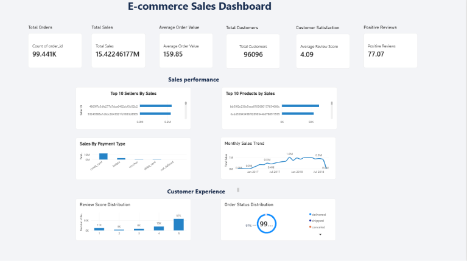

# Brazilian E-Commerce Data Analysis

## 1. Project Overview

This project explores the Brazilian E-Commerce Public Dataset by Olist to analyse sales performance, customer behaviour, payment preferences, order fulfilment, delivery performance, and customer satisfaction.

The objective is to transform raw e-commerce data into meaningful business insights using Python, PostgreSQL, and Power BI.

## 2. Tools & Technologies

- **Python** – Data analysis
- **NumPy** – Numerical operations
- **Pandas** – Data cleaning and manipulation
- **PostgreSQL** – Data querying and aggregation
- **Power BI** – Dashboard development and visualisation

## 3. Dataset

The project uses the Brazilian E-Commerce Public Dataset by Olist.

It contains information about:
- Orders
- Customers
- Sellers
- Products
- Order items
- Payments
- Customer reviews

## 4. Project Workflow

1. Explored the dataset and understood its structure.
2. Inspected columns, data types, and missing values.
3. Performed data cleaning and preprocessing using Python and Pandas.
4. Analysed sales, products, sellers, payments, delivery times, and customer reviews.
5. Used PostgreSQL to perform queries and aggregations.
6. Created a Power BI dashboard to visualise key performance indicators and trends.
7. Interpreted the analytical results to identify business insights.

## 5. Key Performance Indicators

| Metric | Result |
|---|---:|
| Total Sales | 15.42 million |
| Total Orders | Approximately 96K |
| Average Order Value | 159.85 |
| Average Review Score | 4.09 / 5 |
| Positive Reviews (4–5 stars) | 77.07% |

*Note: Values are based on the calculations displayed in the project dashboard. Monetary values are in the dataset's original currency (Brazilian Real).*

## 6. Power BI Dashboard

The interactive dashboard contains six main visualisations.

### Sales Performance
- Top 10 Products by Sales
- Top 10 Sellers by Sales
- Monthly Sales Trend
- Sales by Payment Type

### Customer Experience
- Order Status Distribution
- Review Score Distribution

## 7. Business Insights

### 7.1 Sales Performance

- Total sales amounted to approximately 15.42 million.
- The average order value was 159.85.
- November 2017 recorded the highest monthly sales in the analysed period.

### 7.2 Product Performance

- The highest-selling product was `bb50f2e236e5eea0100680137654686c`.
- It generated a sales value of 63,885.
- Identifying top-performing products can help businesses make informed inventory and product-planning decisions.

### 7.3 Seller Performance

- The highest-selling seller was `4869f7a5dfa277a7dca6462dcf3b52b2`.
- The seller generated a total sales value of 229,472.63.
- Seller-level analysis helps identify key contributors to platform sales.

### 7.4 Payment Analysis

- Credit card payments generated the highest total payment value.
- The total payment value through credit cards was 12,542,084.19.
- This highlights the importance of credit cards as a payment channel on the platform.

### 7.5 Order Status Analysis

- Delivered orders formed the largest category in the order status distribution.
- A total of 96,478 orders were delivered.
- This represents approximately 97.02% of the 99,441 orders in the dataset.

### 7.6 Customer Satisfaction

- 77.07% of customer reviews received 4 or 5 stars.
- The average review score was 4.09 out of 5.
- This indicates generally positive customer satisfaction, while the remaining 22.93% of reviews rated 1–3 highlight opportunities for improvement.

### 7.7 Delivery Performance

- The average actual delivery time was approximately 12.56 days.
- Delivery-time analysis helps businesses understand fulfilment performance and identify opportunities to improve the customer delivery experience.

## 8. Project Outcomes

- Gained practical experience analysing a real-world e-commerce dataset.
- Applied Python, NumPy, and Pandas for data exploration and analysis.
- Practised PostgreSQL queries and data aggregation.
- Developed a Power BI dashboard with key business metrics and visualisations.
- Translated analytical results into meaningful business insights.

## 9. Future Scope

- Explore customer purchasing patterns in greater detail.
- Analyse delivery delays and their relationship with customer reviews.
- Investigate seller-level and product-level performance trends.
- Add further interactive dashboard features.

## 10. Conclusion

This project demonstrates an end-to-end data analysis workflow, from data exploration and preprocessing to SQL analysis, dashboard development, and business insight generation.

It provides practical experience in using data analytics tools to understand e-commerce business performance and support data-driven decision-making.